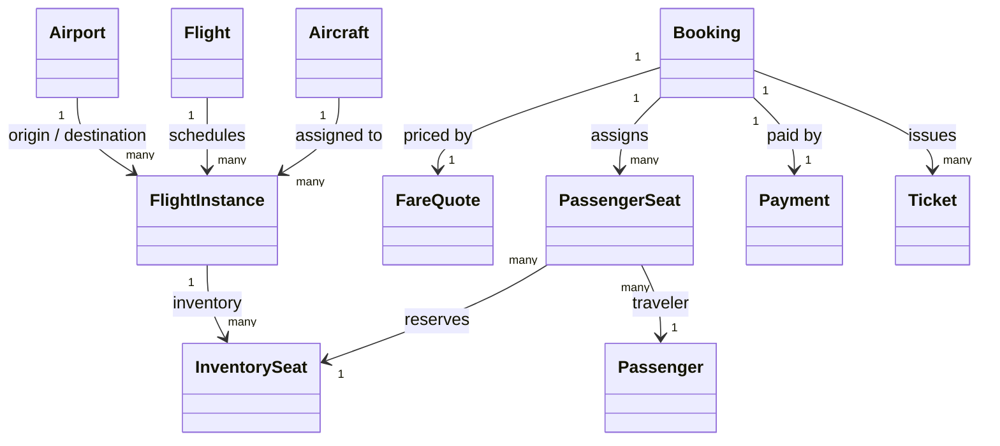
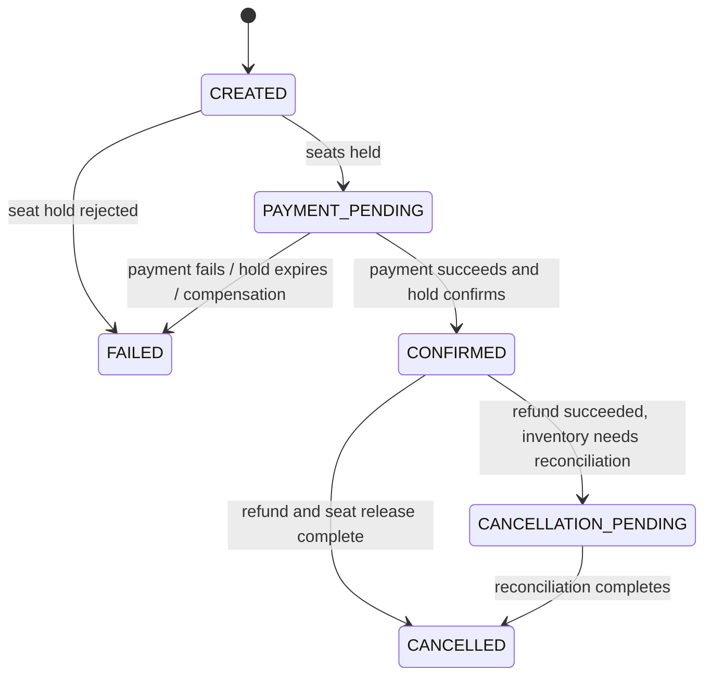
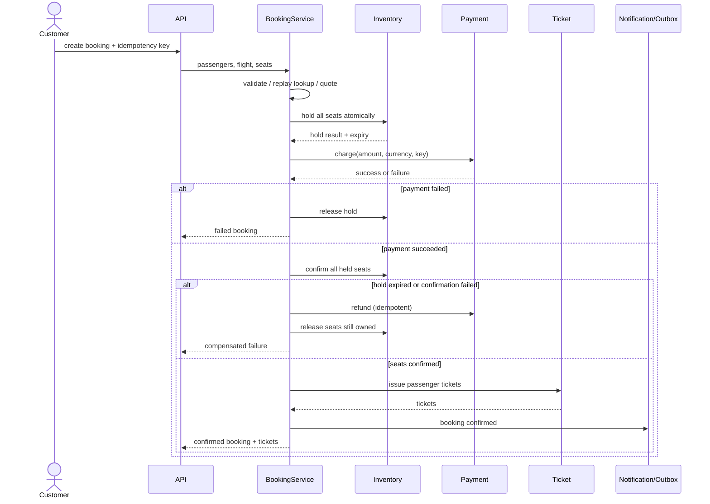

# Flight Booking System: Low-Level Design

## 1. Problem Statement

Design a system that lets a customer find a scheduled direct flight, select seats for one or more passengers, pay, receive tickets, and later cancel a confirmed booking for a refund. The design focuses on correctness of seat inventory and payment orchestration.

### Interview assumptions

- One-way, direct flights only; a booking belongs to exactly one scheduled flight instance.
- A booking can contain multiple passengers, with one distinct seat assigned to each passenger.
- Search filters by origin, destination, origin-local departure date, and minimum available seats.
- The demonstration uses in-memory repositories and a simulated payment adapter. It is not durable and is not safe across multiple processes.
- Fare is selected by seat definition and locked into a quote when booking starts. Prices use `Decimal`; the quote includes a currency code.
- A seat hold lasts ten minutes by default. Holds expire based on UTC-aware timestamps.
- A successful cancellation refunds the payment, releases every seat, and invalidates each ticket. Cancellation rules/fees can be added as policy.
- Customer accounts, authentication, airline operations, loyalty, baggage, check-in, connecting trips, and real notifications are out of scope.

## 2. Requirements

### Functional

1. Register airports, flight definitions, scheduled flight instances, aircraft, and seat definitions.
2. Search scheduled flights by route and origin-local date, with enough available seats for the party.
3. Produce a server-side fare quote for selected seats.
4. Atomically hold all requested seats or hold none.
5. Collect payment idempotently and confirm the seats only while the hold is valid.
6. Issue one ticket per passenger after confirmation.
7. Cancel a confirmed booking idempotently, refund the payment, free the seats, and cancel its tickets.
8. Notify interested systems when booking, payment, or cancellation outcomes change.

### Non-functional

- **No overselling:** seat allocation is serialized/conditional at the inventory boundary.
- **Idempotency:** client retries with the same key and payload return the original booking; reusing a key with a different payload is rejected.
- **Money correctness:** avoid binary floating-point amounts; carry currency with the amount.
- **Time correctness:** timestamps are timezone-aware; search dates are interpreted in the origin airport timezone.
- **Resilience:** failed payment releases holds; a successful charge followed by failed confirmation or ticket issuance is compensated with a refund.
- **Auditability:** bookings, payment attempts, tickets, and state changes should be persistently recorded in production.

## 3. Domain Model

| Entity | Responsibility / important fields |
| --- | --- |
| `Airport` | IATA-like code, name, city, country, IANA timezone. |
| `Flight` | Airline-operated flight definition and flight number. |
| `FlightInstance` | A dated occurrence of a flight: route, departure/arrival instants, aircraft, status. Inventory is scoped to this ID, never just the flight number. |
| `Aircraft` / `SeatDefinition` | Aircraft model and seat number, cabin, base fare. |
| `InventorySeat` | One seat for one flight instance: available/held/confirmed, owner booking, hold expiry. |
| `Passenger` / `PassengerSeat` | Traveler identity and their selected seat for this booking. PII should be minimized and protected. |
| `FareQuote` | Immutable quote ID, flight instance, per-seat prices, total, currency, creation and expiry. |
| `Booking` | Customer request, passengers/seats, quote, idempotency key, payment reference, lifecycle status. |
| `Payment` | Booking, amount/currency, provider outcome, idempotency key, refund state. |
| `Ticket` | Passenger-specific proof of confirmed travel, seat, status. |
| `Notification` | In-memory event record; production counterpart is an outbox/event. |

### Relationships

- One `Flight` has many `FlightInstance`s.
- One `FlightInstance` has one aircraft configuration and many `InventorySeat`s.
- One `Booking` targets one `FlightInstance`, contains one or more passenger-seat assignments, and has one payment plus one ticket per passenger.
- A seat is owned by at most one active booking at a time.



## 4. State Machines



Seat states are `AVAILABLE -> HELD -> CONFIRMED -> AVAILABLE` (on cancellation). An expired hold is logically available; acquiring it replaces the prior owner atomically. A payment can be `SUCCESS -> REFUNDED`; a declined attempt is `FAILED`. Tickets are issued only for confirmed bookings and become cancelled on successful cancellation.

## 5. Component Responsibilities

- `FlightRepository`: store and search scheduled flight instances.
- `InventoryRepository`: list seats and atomically hold, confirm, or release a group of seats. The demo uses an `RLock`; this is a process-local stand-in for database conditional updates/transactions.
- `PriceService`: create a fare quote from seat prices and a configured currency.
- `BookingRepository`: store bookings and index client idempotency keys.
- `PaymentService`: charge/refund through an injected adapter; cache outcomes by idempotency key.
- `TicketService`: issue passenger tickets once per booking and cancel them.
- `FlightSearchService`: combine route/date filtering with available-seat capacity.
- `BookingService`: orchestrate quote, inventory, payment, confirmation, ticketing, cancellation, and compensation.
- `NotificationService`: record outcome events; replace with an outbox plus asynchronous delivery in production.

The runnable implementation is in [`flight_booking_system.py`](flight_booking_system.py). Its demo uses only standard-library dependencies.

## 6. API Sketch

These are interview-level HTTP contracts; the repository contains service-layer code rather than a web server.

### Search flights

`GET /v1/flights?origin=SFO&destination=JFK&departureDate=2027-01-01&passengers=2`

Returns matching scheduled instances with departure/arrival instants, local display values, airline/flight number, and available seat summaries. The date is local to the origin airport.

### Create booking

`POST /v1/bookings`

Headers: `Idempotency-Key: <client-generated-unique-key>`

```json
{
  "userId": "user-1",
  "flightInstanceId": "AC101-2027-01-01",
  "passengers": [
    {"passengerId": "pax-1", "firstName": "Alex", "lastName": "Morgan", "email": "alex@example.com", "seatNumber": "12A"}
  ]
}
```

Returns `201` with booking ID, status, amount, currency, payment status, and passenger ticket IDs. Return `409` for unavailable inventory, `402` for payment rejection, `404` for an unknown/non-bookable flight, and `422` for invalid passengers/seats. A retry with the same key and same payload returns the original result; a different payload returns `409`.

### Get booking

`GET /v1/bookings/{bookingId}`

Returns booking state, passengers/seats, amount/currency, payment state, tickets, and timestamps. Access is authorized for the booking owner or permitted support staff.

### Cancel booking

`POST /v1/bookings/{bookingId}/cancellations`

Headers: `Idempotency-Key: <cancellation-key>`

Returns cancellation/refund status. Repeating a completed cancellation is successful and does not issue a second refund. If refund and seat inventory disagree, return a pending/reconciliation result rather than claiming completion.

## 7. Booking Sequence

1. Validate passengers and ensure seat numbers and passenger IDs are unique.
2. Resolve an existing booking by idempotency key. Return it for the same request fingerprint; reject key reuse with a different request.
3. Verify the flight instance is scheduled and has not departed. Create a fare quote using authoritative seat prices.
4. Persist a `CREATED` booking.
5. Atomically hold every requested seat until the hold expiry. If any seat is unavailable, hold none and mark the request failed.
6. Move the booking to `PAYMENT_PENDING`; charge the exact quote total with a provider idempotency key.
7. If payment fails, release the full hold and mark the booking failed.
8. If payment succeeds, atomically confirm all seats only if the hold still belongs to this booking and is unexpired. If it fails, refund and release what remains owned by the booking.
9. Mark booking confirmed and issue one ticket per passenger. If ticketing fails after payment, refund and release inventory; record failure for reconciliation.
10. Publish confirmation notification/event.



## 8. Cancellation Sequence

1. Load booking and verify it is confirmed (or already in cancellation reconciliation).
2. Refund payment using an idempotent refund operation.
3. Verify all seats are still owned by the booking; release them atomically.
4. Cancel tickets, mark booking cancelled, and emit a cancellation event.
5. If the refund succeeds but inventory release fails, persist `CANCELLATION_PENDING`, emit an alert/reconciliation event, and retry the release. Never report a fully completed cancellation while payment and inventory disagree.

## 9. Concurrency and Consistency

### Seat holds

The critical invariant is: **at most one active booking owns a seat for a given flight instance**. In production, perform a conditional update inside a transaction, for example:

```sql
UPDATE flight_seat_inventory
SET status = 'HELD', booking_id = :booking_id, hold_expires_at = :expires_at
WHERE flight_instance_id = :flight_instance_id
  AND seat_number = :seat_number
  AND (status = 'AVAILABLE' OR hold_expires_at <= :now);
```

Require the affected-row count for every requested seat to match the requested count; otherwise roll back the whole multi-seat hold. Confirm and release with analogous owner/status predicates. Add a unique key on `(flight_instance_id, seat_number)`. Do not rely on a cache lock as the source of truth.

### Payment boundary

A database transaction cannot atomically include an external payment provider. Use provider idempotency keys, persist each attempt, and model the workflow as a saga with compensating refunds. A timeout is an unknown outcome, not proof of failure: query/retry the provider with the same key before releasing inventory. Production systems should persist workflow state and use a reconciliation worker for stuck `PAYMENT_PENDING` or `CANCELLATION_PENDING` records.

### Notifications

Do not publish an external event before the booking transaction commits. Use a transactional outbox written with the booking update; an asynchronous worker delivers it at least once, and consumers deduplicate by event ID.

## 10. Persistence Sketch

- `airport(code PK, name, city, country, time_zone)`
- `flight(flight_id PK, airline, flight_number)`
- `flight_instance(instance_id PK, flight_id FK, origin_code FK, destination_code FK, departure_at, arrival_at, aircraft_id, status)`
- `aircraft_seat(aircraft_id, seat_number, cabin_class, base_fare, currency, PK(aircraft_id, seat_number))`
- `flight_seat_inventory(flight_instance_id, seat_number, status, booking_id, hold_expires_at, PK(flight_instance_id, seat_number))`
- `booking(booking_id PK, user_id, flight_instance_id FK, status, amount, currency, idempotency_key UNIQUE, request_fingerprint, created_at)`
- `booking_passenger(booking_id FK, passenger_id, seat_number, passenger details, PK(booking_id, passenger_id), UNIQUE(flight_instance_id, seat_number))`
- `payment(payment_id PK, booking_id FK, amount, currency, status, provider_reference, idempotency_key UNIQUE)`
- `ticket(ticket_id PK, booking_id FK, passenger_id, seat_number, status, UNIQUE(booking_id, passenger_id))`
- `outbox(event_id PK, aggregate_id, event_type, payload, created_at, delivered_at)`

Store departure/arrival as instants (for example UTC) and retain airport timezone identifiers for local presentation and date search. Production passenger PII needs encryption, access control, retention rules, and audit logging.

## 11. Failure Handling and Invariants

- Unknown flight, cancelled flight, or departed flight: reject before inventory mutation.
- Unknown/duplicate seat or duplicate passenger assignment: reject the request; never partially reserve a party.
- Seat conflict: reject without charging; the failed booking attempt is recorded.
- Declined payment: release all seats held by that booking.
- Payment timeout: resolve provider state idempotently before releasing inventory.
- Hold expires during payment: confirmation predicate fails; refund and release any seats still owned by the booking.
- Ticket issuance fails: compensate with refund and seat release, then reconcile if either compensation fails.
- Repeated create request: return the same booking only when the idempotency key and request fingerprint match.
- Repeated refund/cancel request: do not double-refund or double-release.
- Refund succeeds but inventory release fails: leave an explicit pending state and alert; do not silently mark cancelled.

Core invariants:

1. Confirmed booking implies successful payment and all requested seats confirmed for that booking.
2. Every issued ticket belongs to exactly one confirmed booking and one passenger-seat assignment.
3. A seat is available, held by one booking until expiry, or confirmed for one booking; no overlapping owners.
4. A booking's immutable quote total equals the sum of assigned seat prices in one currency.
5. A completed cancellation has refunded payment, released inventory, and cancelled tickets.

## 12. Verification

Run from the workspace root:

```bash
python -m unittest LLD_Practice.test_flight_booking_system
python -m py_compile LLD_Practice/flight_booking_system.py LLD_Practice/test_flight_booking_system.py
python LLD_Practice/flight_booking_system.py
```

The tests cover search, multiple passengers, atomic conflicting holds, payment failure, expiry/reacquisition, expiry during payment, cancellation/refund/ticket invalidation/seat reuse, idempotent retries, mismatched idempotency keys, ticketing compensation, and unknown flight handling.

## 13. Trade-offs and Extensions

- **In-memory vs database:** in-memory repositories make the object model easy to run and discuss but lose data on restart and coordinate only within one process. Replace repositories with transactional SQL implementations for production.
- **Synchronous orchestration vs workflow engine:** synchronous orchestration is clear for an interview; long-running payment/provider interactions need persisted saga state, retries, deadlines, and reconciliation.
- **Seat-level inventory:** easy to reason about and prevents overselling; high-demand inventory may require sharding/partitioning by flight instance and careful lock ordering for multi-seat requests.
- **Fixed seat price:** illustrates quote ownership and decimal money; production pricing can include fare classes, taxes, discounts, currency conversion, and quote expiry rules.
- **Single direct flight:** keep this service focused. Round trips and connecting itineraries should compose independently bookable flight legs with an itinerary-level workflow and compensation policy.
- **Notifications:** in-memory recorder demonstrates the boundary; production should use outbox delivery and idempotent consumers.
